<picture>
  <source media="(prefers-color-scheme: dark)" srcset=".github/assets/isostack-banner-dark.svg">
  
</picture>

# isostack

Isometric infrastructure icons that are alive: the lights blink, a status changes live, a container opens to show what runs inside. They are plain HTML tags (`<iso-server>`, `<iso-db>`, `<iso-firewall>`...), with zero dependencies.

## Start

One script, one tag:

```html
<script type="module" src="https://cdn.jsdelivr.net/npm/isostack@0.1.0/index.js"></script>

<iso-server label="web-01" status="warn"></iso-server>
```

In React or Vue: `npm install isostack`.

## Settings

| Attribute | What it does | Values |
|---|---|---|
| `status` | the color of the lights, live | `ok` (default), `warn`, `down`, `unknown` |
| `label` | the name on the plate | short text |
| `width`, `depth`, `height` | the size, in grid cells | per component |
| `open` | a container fades its cover to show its inside | boolean |
| `resizable` | blue cubes to resize it with the mouse | boolean |
| `paused` | the lights stand still | boolean |

The same server in HTML, React and Vue.

**HTML, CSS, JS**

```html
<script type="module" src="https://cdn.jsdelivr.net/npm/isostack@0.1.0/index.js"></script>
<style>
  iso-server { --iso-speed: 2; --iso-down: #e11d48; }
</style>

<iso-server id="web" label="web-01" width="7" depth="6" resizable></iso-server>

<script type="module">
  const web = document.querySelector('#web');
  setInterval(() => web.status = web.status === 'ok' ? 'down' : 'ok', 2000);
</script>
```

**React 19**

```jsx
import 'isostack';

export const Server = ({ host }) => (
  <iso-server label={host.name} width={7} depth={6} status={host.status} resizable />
);
```

**Vue 3**

```vue
<script setup>
import { ref } from 'vue';
import 'isostack';

const status = ref('warn');
const save = e => console.log(e.target.width, e.target.depth);
</script>

<template>
  <iso-server label="web-01" :width="7" :depth="6" :status="status" resizable @change="save" />
</template>
```

With Vite, tell Vue that the `iso-` tags are custom elements, in `vite.config.js`: `vue({ template: { compilerOptions: { isCustomElement: tag => tag.startsWith('iso-') } } })`.

## Components

| Tag | Preview | Tag | Preview |
|---|:-:|---|:-:|
| `<iso-server>` |  | `<iso-vps>` |  |
| `<iso-vm>` |  | `<iso-docker>`<br>Docker host |  |
| `<iso-rack>` |  | `<iso-app>`<br>a service in a container |  |
| `<iso-switch>` |  | `<iso-router>` |  |
| `<iso-firewall>` |  | `<iso-load-balancer>` |  |
| `<iso-dns>` |  | `<iso-cloud>`<br>internet |  |
| `<iso-db>` |  | `<iso-cache>` |  |
| `<iso-queue>` |  | `<iso-bucket>` |  |
| `<iso-storage>`<br>NAS |  | `<iso-user>` |  |
| `<iso-laptop>` |  | `<iso-phone>` |  |
| `<iso-desktop>` |  | `<iso-raspberry-pi>` |  |

Containers hold other elements:

```html
<iso-vps open width="10" depth="7" height="4" label="vps-01">
  <iso-docker x="1" z="1" width="8" depth="5" label="stack">
    <iso-app x="1" z="1.5" label="web"></iso-app>
    <iso-app x="4.5" z="1.5" label="api"></iso-app>
  </iso-docker>
</iso-vps>
```

Events, CSS variables, static `.svg` files without JS, the icon pack for isoAtlas and large scenes: see the [guide](docs/guide.md).

## License

[MIT](LICENSE)
